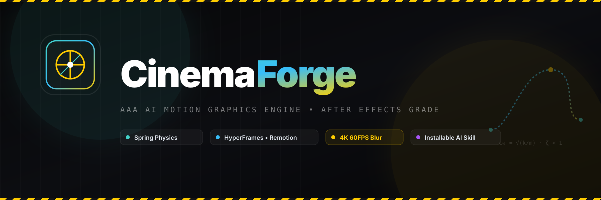

<p align="center">
  
</p>

<h1 align="center">CinemaForge</h1>

<p align="center">
  <strong>After-Effects-grade motion graphics, authored entirely by AI agents.</strong>
</p>

<p align="center">
  <a href="#install">Install</a> •
  <a href="#what-it-does">What It Does</a> •
  <a href="#video-categories">Video Categories</a> •
  <a href="#examples">Examples</a> •
  <a href="#credits">Credits</a>
</p>

<p align="center">
  
  
  
  
</p>

---

## What Is CinemaForge?

**CinemaForge** is a free, open-source AI agent skill that teaches any AI coding assistant to produce **professional-grade motion graphics** — the kind of work that looks like it was hand-crafted in Adobe After Effects by a senior motion designer.

It encodes the **complete discipline** of motion design into a single skill file:

- 🎬 **Physics-based easing** — spring dynamics, cubic-bezier curves, overshoot/settle
- 🎭 **The 12 Principles of Animation** applied to motion graphics code
- 🏗️ **Scene architecture** — dramatic hook → build → reveal → resolve narrative arcs
- 🎵 **Beat-synced timing** — transitions land precisely on rhythmic beats
- ✨ **Kinetic typography** — text that communicates through movement, not just words
- 🧩 **Component library** — phone mockups, browser windows, dashboard cards, charts
- 🎨 **Color systems** — dark-mode-first palettes, ambient glow, film grain, glassmorphism
- 📹 **Export pipeline** — 4K 60fps with 4× subframe motion blur

> **Inspired by [Null Motion](https://www.nullmotion.com/)** — the groundbreaking AI motion graphics editor that proves code-driven video can rival professional After Effects work.

---

## Install

### For AI Agents (Antigravity, Claude Code, Cursor, etc.)

Just paste this URL to your agent and say **"Install this skill"**:

```
https://github.com/birulyy2121/CinemaForge
```

Or add it to your agent's skills directory:

```bash
# Clone into your skills folder
git clone https://github.com/birulyy2121/CinemaForge.git ~/.agents/skills/cinemaforge
```

### Manual Setup

1. Clone this repository
2. Copy the `SKILL.md` file into your agent's skills directory
3. Optionally copy the `examples/` folder for reference compositions

---

## 🚀 Quick Install & Activation

### 1. Tell your agent to install the skill:
Simply copy and paste this URL into your conversation with **Antigravity**, **Claude Code**, **Cursor**, or **Codex**:

> *"Install this skill: https://github.com/birulyy2121/CinemaForge"*

### 2. Activate or reference the skill:
Once installed, your agent automatically knows CinemaForge! You can also explicitly say:
> *"Use the cinemaforge skill to make this video."*

---

## 🗣️ What to Tell Your Agent (Copy & Paste Prompts)

Here are the battle-tested prompt recipes you can copy, fill in, and send directly to your AI agent:

### 🚀 1. SaaS Product Launch Ad (30 Seconds, 16:9)
```text
Create a 30-second AAA-tier SaaS product launch video using CinemaForge and HyperFrames for [My Product].
- Palette: Midnight obsidian (#070708) with electric teal (#43d3c9) accents
- Hook (0–3s): Stop-the-scroll kinetic typography: "[Problem statement]"
- Build (3–12s): 3 staggered pain-point cards with back.out(1.7) overshoot
- Reveal (12–22s): Desktop browser mockup with spring entry, live animated odometer counters, and SVG feature lines
- Resolve (22–30s): Logo settle with breathing scale and CTA button pulse
- Render: 4K 60fps with 4x subframe motion blur and subtle film grain overlay
```

### 📱 2. Viral Social Reel (15 Seconds, 9:16 Vertical)
```text
Make a 15-second 9:16 vertical motion graphics reel using CinemaForge for Instagram Reels / TikTok.
- Topic: "[e.g. 5 rules of high-end UI design]"
- Framing: Centered 9:16 smartphone viewport with notch and dark-mode UI
- Pacing: High velocity with 0.3s snappy transitions
- Keyframes: Staggered numbered badges with glow pulse, kinetic word pops on key phrases
- Loop: Ensure the ending frame seamlessly transitions into the first frame for infinite auto-looping
```

### 🔤 3. Kinetic Typography Manifesto Video (20 Seconds)
```text
Create a 20-second kinetic typography manifesto video using CinemaForge.
- Voice/Script: "[Insert your 4-line script here]"
- Typography: High-contrast mix of italic serif (Fraunces/Instrument Serif) and bold grotesque (Geist/Inter)
- Motion: Character cascade text entries, beat-synced word punches (scale 1.5 -> 1.0 with back.out(2)), and line wipes
- Invariant: Zero linear easing. Every word must have weight, momentum, and follow-through.
```

### 📊 4. Executive KPI Dashboard & Data Showcase
```text
Build a data showcase video in HyperFrames using CinemaForge.
- Metrics: Monthly Revenue ($2.4M), Active Users (48,200), Response Time (42ms)
- Animations: Numbers must roll like odometers using power2.out, bar charts grow with spring physics, circular SVG progress rings fill dynamically
- Visuals: Dark glassmorphic cards with 20px backdrop blur, subtle ambient radial glow, and hair-line borders
```

### ⚛️ 5. Remotion (React + TypeScript) Video
```text
Create a Remotion composition in React using CinemaForge motion design principles.
- Use spring() with closed-form physics (stiffness: 180, damping: 12, mass: 1)
- Never use linear interpolation or default transitions
- Stagger children components with frame delays
- Implement dark mode styling with subtle noise grain overlay
```

---

## What It Does

When you tell your AI agent to **"make a product launch video"** or **"create a motion graphics ad"**, CinemaForge activates and ensures the agent:

| Without CinemaForge | With CinemaForge |
|---------------------|------------------|
| Linear, robotic motion | Spring physics with overshoot & settle |
| All elements appear at once | Staggered reveals with natural timing curves |
| Default system fonts | Premium type stacks (Inter, Geist, Satoshi) |
| White backgrounds | Dark-mode-first with film grain & ambient glow |
| Generic "AI-made" look | Agency-quality professional polish |
| Random timing | Beat-synced transitions on rhythmic beats |
| Hard cuts only | Crossfades, push transitions, scale morphs, depth blurs |
| No text animation | Character cascades, word punches, line wipes, gravity drops |

### The Three Laws

1. **Nothing moves linearly.** Every property uses physics-based easing.
2. **Nothing appears without motivation.** Every element has anticipation, purpose, follow-through.
3. **Nothing exists in isolation.** Motion relates to neighbors through stagger, rhythm, hierarchy.

---

## Video Categories

CinemaForge supports **six professional video categories**, each with its own dramatic structure, motion language, and timing rules:

### 🚀 1. Product Launch Ad
The flagship format. Bold hook → pain point → product reveal → features → metrics → CTA.

### 💻 2. SaaS Feature Explainer
Animated UI walkthrough with cursor simulation, click effects, and tooltip springs.

### 🔤 3. Kinetic Typography Manifesto
Every word animated individually. Scale, color, and rhythm build to a climax.

### 📊 4. Data / Metric Showcase
Counter animations, bar chart growth with springs, percentage ring fills.

### 📱 5. Social Media Reel (9:16)
Vertical-first with 0.3s transitions, bolder scale, auto-looping.

### 🎨 6. UI/UX Animation Showcase
Realistic interactions, micro-animations, design system in motion.

---

## The Physics Engine

CinemaForge provides a complete, deterministic, seekable physics system:

### Spring Physics
```javascript
// Underdamped harmonic oscillator — no libraries needed
const value = cfSpring(t, 0, 100, { tension: 170, friction: 26, mass: 1 });
```

### Signature Easing Curves
```javascript
const CF_EASE = {
  snapIn:    "cubic-bezier(0.16, 1, 0.3, 1)",      // Hook entries
  smoothOut: "cubic-bezier(0.55, 0, 0.1, 1)",       // Exits
  punch:     "cubic-bezier(0.22, 1, 0.36, 1)",      // Feature reveals
  glide:     "cubic-bezier(0.25, 0.1, 0.25, 1)",    // Ambient
  whip:      "cubic-bezier(0.9, 0, 0.1, 1)",        // Fast cuts
};
```

### Overshoot & Settle
The #1 technique that separates amateur from professional: elements go **past** their target and settle back.

---

## Examples

See the [`examples/`](examples/) directory for complete, annotated compositions:

- **`product-launch.html`** — Full 30-second product ad with all techniques
- **`kinetic-type.html`** — Pure typography manifesto video
- **`dashboard-reveal.html`** — SaaS UI showcase with metric counters
- **`social-reel.html`** — 9:16 vertical social media reel

Each example is a complete HyperFrames composition that renders to 4K 60fps MP4.

---

## Render Targets

CinemaForge works with both major code-to-video frameworks:

| Framework | Language | Animation Engine | License |
|-----------|----------|-----------------|---------|
| **HyperFrames** | HTML/CSS | GSAP | Apache 2.0 |
| **Remotion** | React/TypeScript | useCurrentFrame() | Dual |

The skill is framework-agnostic — the motion principles, physics, and design rules apply to both.

---

## Quick Reference

```
EASING:          power3.out (default) | power4.out (snappy) | back.out(1.7) (bouncy)
SPRING:          cfSpring(t, from, to, { tension, friction, mass })
DURATION:        0.3s (micro) | 0.6s (standard) | 1.0s (cinematic) | 1.5s (epic)
STAGGER:         0.03s (chars) | 0.06s (words) | 0.1s (cards) | 0.15s (sections)
OVERSHOOT:       15% for UI | 25% for playful | 5% for subtle
GRAIN:           fractalNoise, opacity 3–5%, overlay blend
SAFE ZONE:       10% padding all edges
FRAMERATE:       60fps output, 240fps capture for 4× motion blur
```

---

## Project Structure

```
CinemaForge/
├── SKILL.md                    # The skill file — this is what agents read
├── README.md                   # This file
├── LICENSE                     # MIT License
├── CONTRIBUTING.md             # How to contribute
├── AGENTS.md                   # Agent-specific instructions
├── assets/
│   └── cinemaforge-banner.svg  # Repo banner
├── examples/
│   ├── product-launch.html     # Full product launch ad
│   ├── kinetic-type.html       # Kinetic typography manifesto
│   ├── dashboard-reveal.html   # SaaS dashboard showcase
│   └── social-reel.html        # 9:16 social media reel
└── references/
    ├── easing-curves.md        # Deep dive into easing mathematics
    ├── spring-physics.md       # Spring physics implementation guide
    └── typography-motion.md    # Complete kinetic typography reference
```

---

## 👥 Authors & Core Contributors

Built with precision by:

- **[birulyy2121](https://github.com/birulyy2121)** — Creator & Architecture Lead
- **[Google Antigravity](https://github.com/google-deepmind)** — Autonomous Systems & Multi-Agent Protocol Integration
- **[Arsh118198Imad](https://github.com/Arsh118198Imad)** — Core Engine & Agent Runtime Mechanics
- **[arhamshahbaz3499-ux](https://github.com/arhamshahbaz3499-ux)** — UX Lead, Terminal Interface & Design System
- **[shahzebejazsyed-gif](https://github.com/shahzebejazsyed-gif)** — Visual Assets & Media Architecture

### Acknowledgments

- **[Null Motion](https://www.nullmotion.com/)** — The pioneering AI motion graphics editor that inspired this project
- **[GSAP](https://greensock.com/gsap/)** — The animation platform that makes code-driven motion possible
- **[HyperFrames](https://github.com/nichochar/hyperframes)** — The HTML-to-video framework
- **[Remotion](https://remotion.dev/)** — React-based programmatic video

---

## License

MIT License — free forever, for everyone.

---

<p align="center">
  <strong>Stop making videos that look AI-generated. Start making videos that look agency-crafted.</strong>
</p>
